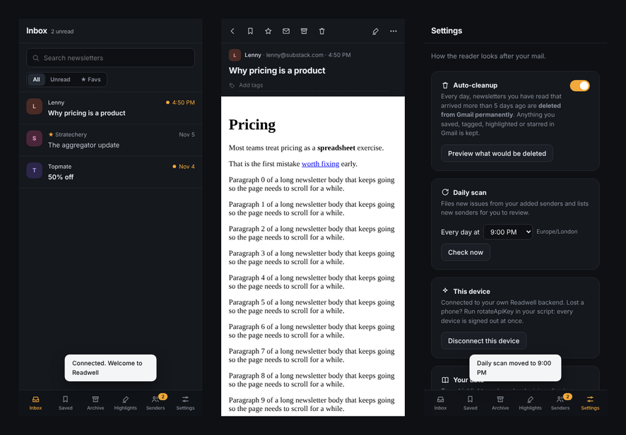
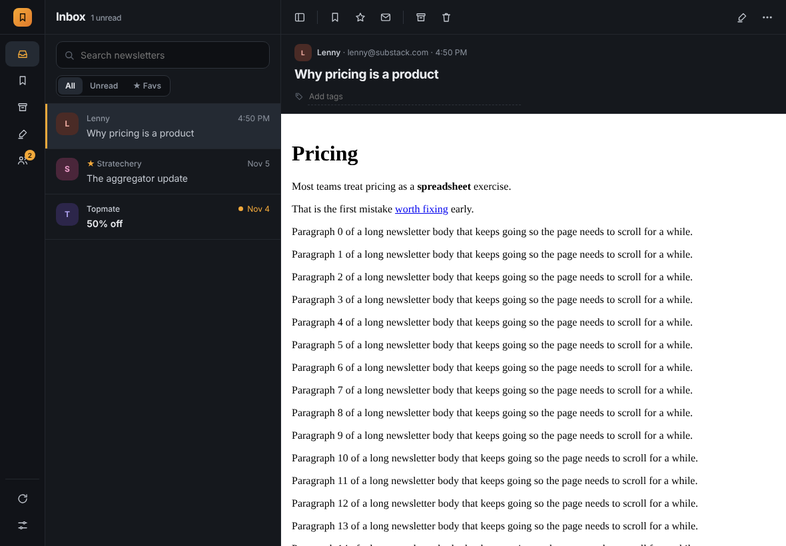

# Readwell

I wanted Meco without Meco. So I built my own newsletter reader on top of Gmail, without writing code myself. Claude wrote all of it.

It's free, it has no servers, and your mail never leaves your Google account. Use it as it is, or fork it and make it yours.

## What it does

- **Finds your newsletters.** A daily scan spots senders that look like newsletters. You tap Add or Ignore. That's the only sorting you ever do.
- **Gets them out of your inbox.** Issues from added senders skip Gmail's inbox and land in Readwell.
- **Lets you read properly.** A dark, calm reader. Each newsletter keeps its own design. One scrolling page, a toolbar that hides.
- **Highlights, notes and tags.** Select text to highlight it, find every highlight later in one place.
- **Cleans up after you, if you want.** Read issues older than 5 days can be deleted for you, except anything you saved, tagged, starred or highlighted. Off until you switch it on.
- **Works everywhere.** Phone, tablet, laptop, portrait and landscape. Installs on your home screen.

## Use it

About 4 minutes, once, on a laptop:

**[Open the setup guide](https://kaizenminds.github.io/readwell/setup.html)**

1. Copy the backend into your Google account (one click).
2. Deploy it.
3. Open the link it gives you, then tap the button in the email it sends you.

## How it works

| Part | Runs where | Folder |
|---|---|---|
| Backend: Gmail scan, sender rules, cleanup, storage | Google Apps Script, inside your own Google account | `backend/` |
| App: the reader you see | A web page on GitHub Pages, installable as an app | `app/` |
| Your data | Gmail labels plus a Google Sheet in your Drive | made on setup |

Every user runs their own copy of the backend. That's why it costs nothing, has no user limit and needs no Google security review. The app only ever talks to your own backend, using a private key that is emailed to you and nobody else.

## Make it yours

Fork the repo, then:

1. **Turn on hosting.** In your fork: Settings, Pages, Source: GitHub Actions. Every push to `app/` publishes your app at `https://<your-username>.github.io/readwell/`.
2. **Point the backend at your app.** In `backend/Code.gs`, change `APP_URL` to your Pages address.
3. **Set it up for yourself** with your own setup page. It adjusts its links to your fork automatically.

Where things are:

- `backend/Code.gs` is all the server logic in one file.
- `backend/Index.html` is the reader UI. `tools/build_app.py` turns it into the installable app (`app/index.html`), so you edit the UI in one place and run `python3 tools/build_app.py`.
- `CLAUDE.md` holds the rules for anyone, human or AI, working on the code. Open the repo with Claude and it picks them up.
- `docs/roadmap.md` has what's done and what's next.

Ideas people could build: a weekly digest of your highlights, export to Notion or Readwise, read-aloud, AI summaries using your own API key.

## Status

Beta. Works daily for me. Expect rough edges, and open an issue if you hit one.

## License

MIT. Do what you like with it.
